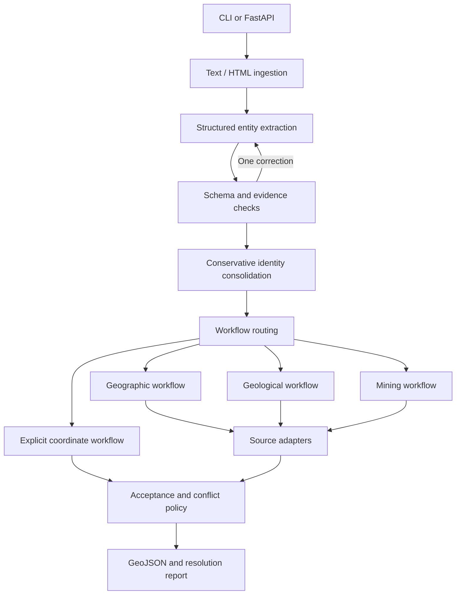

# Georeferencer

## System design

The [interactive data-flow diagram](docs/diagrams/agent-dataflow.html) shows the
objects passed between processing steps, exact property names, full JSON examples,
all classification values, generated schemas and model-call metadata. Open the HTML
in a browser; it works offline. [build_dataflow.py](scripts/build_dataflow.py)
rebuilds it from current contracts and a saved Monte do Carmo result without calls
to models or external APIs. Saved and reconstructed examples are labelled separately.

Start with the [current system and production additions](docs/system-design.md).
It describes the implemented architecture and reasoning workflow, then proposes
how to improve evidence retrieval, recovery, evaluation and durable execution.
It addresses the assignment's five focus areas and explicitly separates existing
features from future work.


The [workflow diagram](docs/diagrams/current-workflow.svg) shows extraction,
semantic-unit grouping, geocoder retries, shared discovery, source verification,
coordinate acceptance and review flags. The diagram sources are editable Mermaid
files under `docs/diagrams/`; [render_diagrams.py](scripts/render_diagrams.py)
regenerates SVG/PNG/PDF without model calls. Node.js is only needed to regenerate
images, not to run the app.

The default library contains six representative public documents: the ROB claims
geological report/offering statement, BCGS GeoFile 2025-11 on drillhole data, and the
West McArthur summer drilling release, plus Newsfile releases on Apuradita channel
sampling (306609), Monte do Carmo / Serra Alta drilling (131103), and Phoenix JV /
Moss target drilling (233175). Run `georeferencer seed-library` to download
originals, then `georeferencer analyze-library` to analyze and save results. Completed
version-matching reports are reused; startup never invokes the LLM. Long default
documents use bounded extraction chunks with versioned disk caches. Saved reports
remain available even when some evidence cannot be validated. The current 10 MB
ordinary upload limit remains in place.

The LLM additionally supplies `verification_classes` metadata: `geographic_place`,
`mineral_tenure`, `drilling_site`, `geological_feature`, `mineral_site`, or `unknown`.
Multiple supported classes are allowed; unknown cannot accompany a known class.
These describe potential verification source families and are shown in entity metadata
and GeoJSON properties. Mineral tenure, drilling site, and mineral site metadata route mining assets to
shared web verification rather than locality geocoding when coordinates are needed. They do not assert confirmation.
Older results retain their original labels and display as unclassified; no startup
reanalysis occurs. The prompt/cache version changes when this metadata is introduced.

Track A interview POC: a Python/FastAPI pipeline that extracts geographic entities,
verifies claims through domain-specific sources, and emits evidence-backed GeoJSON.
The CLI and API use the same pipeline. Unresolved entities and errors remain visible.

`GEO_REASONING_EFFORT` optionally sets the model's reasoning effort. Leaving it
blank uses the provider default. The selected app default is `gpt-6.1-sol` with
`low` reasoning. Model and reasoning changes invalidate extraction
and web caches. For a one-document experiment without changing `.env`, run
`python scripts/compare_model.py --model gpt-6.1-sol --reasoning medium`.
This uses the saved Apuradita text and current prompt, skips web search, and keeps
geocoder verification enabled. Successful runs replace the current library result;
history and a comparison artifact under `output/model-tests` retain the baseline.

## Document library UI

Location details show role, verification type, coordinates, and coordinate source.
The LLM returns mentions as plain location-expression strings. Python finds all
verbatim occurrences (allowing whitespace differences) and derives offsets and
surrounding context. Canonical names remain separate from mention expressions.
Coordinate evidence retains its stricter numeric/passage validation. The role
`not_relevant` excludes supporting locations such as analytical laboratory cities
from verification and GeoJSON; legacy `incidental` values remain readable.
The type filter uses verification classes. Mentions show document context and link
to their highlighted occurrences; verification details and full diagnostics are collapsed;
resolution failures show an explicit explanation. For unanchored mentions, the UI
compares the saved quote and prefix/suffix with document text, including older runs.
Source download, document parsing, and evidence rejection are reported separately
with the source URL and error type. PDF URLs returning HTML are rejected before
PDF parsing. Source downloads allow one retry for network failures, counted against
the source-call budget; HTML verification pages are not automatically retried.
Identity support without accepted coordinates is displayed with its source link.

Opening a document defaults to **GeoJSON**, with formatted output and copy/download
controls. Mentions are collapsed by default and expand to show their document anchors.
**Raw LLM output** shows extraction responses. Each selected location has separate
collapsible sections for **Mentions in document**, **Web search results**, and
**Deterministic checks**. Search and check sections appear only when applicable to
that entity, and all sections start collapsed. Web results include proposed candidates,
quotes, source links, search actions, exact model responses, and the app's verification
outcome. Expanding deterministic checks loads the current run's saved logs to show
that location's query attempts, cache hits, returned records, and errors. Opening
these sections never starts analysis or makes model calls.
**Entities & evidence** contains the complete location explorer, including
unresolved and excluded entities. No-match verification results distinguish search
candidates from accepted matches. Documents excluded from the library are hidden
while their originals and run history remain stored.

```powershell
.\.venv\Scripts\georeferencer serve
```

Open `http://127.0.0.1:8000/`. Upload a document, drag/drop a file, or enter a public URL.
Use **Try a synthetic example** to explore the UI without credentials. Real documents
use the configured extraction model and verification sources described below.
The UI checks `/capabilities` and displays missing model/API-key configuration;
the endpoint reports only booleans and never exposes credentials. After changing
server environment variables, restart the server to pick them up.

The library provides document cards, location filters by verification class, metadata,
document evidence highlighting, selected geometry provenance, verification source links
when available, GeoJSON/original downloads, token totals, errors, structured events,
and retained run history. It includes unresolved and excluded entities, even though
those have no GeoJSON feature. **Run again** retries from the stored original document;
URL documents are not re-downloaded once an original has been successfully stored.
Live retries can incur new model/provider usage.

SQLite stores originals, extracted text, reports, and history in `data/library`;
override with `GEO_LIBRARY_DIR`. Parsing/model work runs in background tasks with at
most two active library jobs per server process. Jobs are not durable: restart marks
unfinished documents `interrupted`, and the UI permits an explicit retry. Use one
server worker for this POC; a production queue is needed for multi-worker recovery.

Supported uploads/downloads: UTF-8 text/HTML and text-based PDFs, at most 10 MB and
100,000 extracted characters. PDF input is limited to 150 pages. Scanned/encrypted
PDFs fail with actionable errors; OCR is not implemented. The UI never renders
uploaded HTML as active markup. URL import permits public HTTP(S) on standard ports,
checks each redirect, pins connections to validated public IP addresses, and enforces
byte/timeout limits. It is not a general authenticated browser or crawler.

Library endpoints: `GET /library`, `POST /library/upload`, `POST /library/url`,
`POST /library/demo`, `GET /library/{id}`, and document-specific `/retry`, `/runs`,
`/events`, `/geojson`, `/original`. Upload/import/retry returns 202 immediately;
poll the document to see final status. A failed import is retained with its errors.

Browser smoke test (optional, requires Playwright and an installed Chromium browser):

```powershell
.\.venv\Scripts\python -m pip install playwright
.\.venv\Scripts\python tests/ui_smoke.py --base-url http://127.0.0.1:8000 --browser "C:/Program Files/Google/Chrome/Application/chrome.exe"
```

## Setup

Python 3.11+:

```powershell
python -m venv .venv
.\.venv\Scripts\python -m pip install -e ".[dev]"
```

On Linux/macOS use `.venv/bin/python` and `.venv/bin/georeferencer`.
For exact dependency versions used during verification, install `requirements.lock.txt`
first, then install the project with `pip install -e . --no-deps`.

Both the server and CLI automatically load `.env` from their working directory.
Existing shell environment variables take precedence. Use `.env.example` as a template;
the actual `.env` file is git-ignored. Restart the server after editing it.

## Run the offline demo

```powershell
.\.venv\Scripts\georeferencer run fixtures/demo.txt --extraction-fixture fixtures/demo.extraction.json --registry fixtures/demo.registry.json
```

The fixtures are explicitly **synthetic**, including their coordinates. Fixture mode
replays supplied extraction JSON; it is not an offline LLM and does not measure extraction accuracy.
The demo produces:

- A project representative point from document coordinates.
- A permit representative point from a normalized local registry.
- An unresolved zone, which does not inherit the project's coordinates.
- An excluded company contact location.

`output/<request_id>.geojson` contains accepted features.
`output/<request_id>.report.json` includes entities, relationships, verification results,
issues, and token usage. `logs/<request_id>.jsonl` records structured execution events.
Partial runs exit 0 with an explicit `partial` status; failed runs exit 1.

## Live extraction

Long-document library extraction processes chunks sequentially. Each request receives
the existing locations (stable IDs, names/aliases, types, roles, identifiers and known
geography) and multiple geographic contexts with evidence and entity scopes. The
model reuses an existing ID when the current chunk adds mentions or coordinate
evidence to that location. Python checks identity/type/geographic compatibility and
merges compatible updates as chunks arrive. Conflicting references stay separate
with an explicit diagnostic; a region is never applied to every entity automatically.
No additional reconciliation model pass is made.

Web discovery and downloaded-source verification return an explicit coordinate
format (`decimal`, `dms`, `projected`, or `unknown`). Decimal claims carry copied
longitude/latitude; DMS claims carry original hemisphere-bearing expressions;
projected claims carry Easting/Northing, optional elevation, units and CRS metadata.
Each candidate can contain separate lists of coordinate, header and CRS quotations.
Python checks each quotation against the retrieved source and checks the copied
values before conversion. An unlabelled table row can be interpreted by the model
using quoted headers without a fixed table layout. The model's column/scope
interpretation remains a semantic judgment: quotation checks establish source
support, not proof that the mapping is correct. Original fields, quotations and
transformation metadata remain inspectable. Older singular-quote responses remain
readable, while updated prompt versions invalidate fresh model-response caches.

Discovery is shared per semantic spatial unit: a mining project/site, region,
mountain range, basin or geological province. For example, a Pyrenees geology report
can use the Pyrenees as the grouping anchor for its discussed locations. Extraction
classifies each entity as `general_geographic`, `semantic_unit`, or
`subaltern_location`. A subaltern has a `semantic_unit` field referencing its
parent's stable entity ID. Unit anchors and general geographic context have a null
parent. These kinds are separate from physical subtype, verification class and role.
The live schema requires the kind and parent field in the first recognition response;
the raw LLM table displays both. Legacy `project_ids` are retained for reading older
reports, but are no longer requested from the model.

For example, Pyrenees is a semantic unit, France and Spain are general context,
and discussed peaks/outcrops are subaltern locations linked to the Pyrenees.
`semantic_unit_extents` contains bounding boxes and extreme-point entity IDs based
only on resolved, explicitly linked subalterns. It excludes geographic context,
excluded/unresolved points and the unit anchor's own representative point. These
are extents of observed locations, not inferred boundaries of the whole region.
Longitude wrapping is handled for groups crossing the antimeridian. Eligible extents receive a compact Sol plausibility review. Suspicious locations
retain their coordinates and receive a visible `flagged` tag and review reasons.
See [geographic review](docs/geographic-review.md) for the policy and limits.

Using the unit and its linked members,
each group discovery request contains all its candidate entities and asks Luna
for up to four useful shared documents. Python downloads each proposed source once,
then Sol verifies requested entities in batches of up to six. Each logical project
discovery request can perform up to two web-tool actions. The eight-request discovery
allowance now applies to projects/standalone groups, not individual holes. A failed
group request is reported to its members without triggering per-hole searches.

Known input coordinates and accepted cached evidence skip new discovery. Cached
discovery, downloaded reports and verification responses are reused when their
inputs match. Failed/limited verification batches preserve completed earlier batches.
Metadata and the debug view show project IDs, the full discovery membership and
ranked document proposals. Unassigned locations remain standalone with a diagnostic
when a subaltern's parent is missing or invalid; a dependency is never guessed from
a shared country/province. Older explicit associations remain readable.
Matching hole names in different projects are kept separate. Complete page/table
retrieval remains future work: source verification still uses bounded text excerpts.

Chunk caches include the accumulated context as well as the document, model and
prompt versions. The **Raw LLM output** view exposes the exact context supplied to
each extraction response. Existing saved documents/results remain unchanged until
explicitly analysed again; old extraction caches are not reused by the new prompt.

```powershell
$env:OPENAI_API_KEY = "your-key"
$env:GEO_MODEL = "your-structured-output-capable-model"
$env:GEO_REGISTRY_PATH = "path/to/normalized-registry.json"
.\.venv\Scripts\georeferencer run path/to/press-release.html
```

Choose a model available to your account; no model name is silently substituted.
For this POC, use `GEO_MODEL=gpt-6.1-sol` and `GEO_REASONING_EFFORT=low` in `.env`.
The adapter uses the Responses API with a strict JSON schema, following
[official OpenAI structured-output documentation](https://developers.openai.com/api/docs/guides/structured-outputs).
API credentials are read from the environment, not committed or included in logs.
SDK retries are disabled. Schema/evidence errors allow one correction call with feedback.
Authentication failures, timeouts, and other provider failures are surfaced rather than retried silently.

The core pipeline accepts text/HTML. The library adds downloading and PDF text extraction
before pipeline execution. OCR and map georeferencing are not implemented; supported
UTM coordinates with complete CRS evidence are converted using PROJ.

## API

```powershell
.\.venv\Scripts\georeferencer serve
```

Interactive API documentation: `http://127.0.0.1:8000/docs`.

`POST /georeference`:

```json
{
  "name": "release.txt",
  "content": "Document text goes here",
  "format": "text",
  "include_context": false
}
```

The response contains `request_id`, `status`, `geojson`, `entities`, `relationships`,
`issues`, and `usage`. `X-Request-ID` matches the response and log filename.
Completed and partial runs return HTTP 200; processing failures return 502;
invalid request schemas return 422. Unexpected application failures return 500.
`GET /health` checks process liveness, not provider readiness.
The direct georeferencing endpoint accepts at most 100,000 content characters.
Client-supplied fixture and registry paths are not accepted. Configure verification
sources on the server; document URLs are handled by the separate library import endpoint.

## Domain schema

| Category | Subtypes | Verification route |
|---|---|---|
| `general_geographic` | settlement, administrative_area, mountain, volcano, river, lake | Gazetteer/geocoder |
| `geological` | intrusion, formation, fault, geological_unit | Survey export |
| `mining` | project, property, permit, mine, drill_hole, mineralized_zone | Registry export |
| `other` | facility, unknown | Explicit coordinates only in this POC |

The LLM returns distinct entities with exact text quotes, optional immediate prefix/suffix
context, aliases, namespaced identifiers, geographic context, and coordinate claims.
Python resolves each quote to character offsets (`start`, inclusive; `end`, exclusive)
in the ingested text and attaches that text's SHA-256. Offsets count Python Unicode
characters, not bytes. For HTML they refer to extracted text, not HTML source positions.
Repeated quotes require context that uniquely identifies the occurrence; ambiguity
triggers correction rather than silently selecting the first occurrence.
Quotes plus context can be re-resolved when earlier text shifts; offsets and the hash
identify the specific version. Edits to the quoted text itself require a new anchor.
The schema rejects category/subtype mismatches and invalid optional relationship references.
Python checks quotes against document text and coordinate values against quotes.
These checks verify evidence presence, not the correctness of semantic interpretation.

Live structured output asks for the fixed subtype; Python derives its category, preventing
incompatible category/subtype pairs. Evidence matching tolerates whitespace changes from
HTML/PDF wrapping while preserving original offsets and verbatim stored quotes. Redundant
context inside a unique full-clause quote is removed deterministically. Repeated quotes
still require disambiguation. After one correction, unsupported mentions/coordinate claims
are quarantined individually; entities without valid mentions cannot supply geometry.
Valid entities survive a failed correction. Correction attempts remain in structured events;
only persistent problems appear in the active issues list. Ordinary missing geometry is an
unresolved result with a reason, rather than an application error.

Relationships are optional internal metadata, not GeoJSON requirements. Live extraction
does not request them. Fixtures/custom extractors may supply them to aid identity handling.
Missing coordinates are represented by `coordinate_claims: []`; external verification
still runs. If no source establishes geometry, the entity remains in the report as
unresolved and is omitted from the GeoJSON features.

Roles are independent of type: `primary_subject`, `subject_component`,
`context_location`, `corporate_contact`, `incidental`, `unknown`.
Only primary subjects and subject components are output by default;
`--include-context` also processes context locations.

## Architecture and extension points



- `models.py`: shared, validated domain models and fixed typology.
- `extraction.py`: `Extractor` protocol, live LLM adapter, explicit fixture adapter.
- `sources.py`: `Source` protocol, normalized JSON registry, Nominatim adapter.
- `workflows.py`: `Workflow` protocol, coordinate validation, reusable conservative source matching.
- `pipeline.py`: routing, limits, failure isolation, acceptance, serialization.
- `observability.py`: per-run JSONL events, usage, actionable structured issues.

Source adapters retrieve normalized candidates. Workflows assess identity and claims.
The pipeline selects geometry and writes output. Workflows return results without
mutating entities or writing files.

To add drill verification:

1. Implement a source adapter with `async search(entity, refined=False)` returning `Candidate` records.
2. Implement a workflow with `supports(entity)` and `async verify(entity, ctx)` returning `VerificationResult`.
3. Register it in `default_workflows`, or inject a workflow list into `Pipeline`.
4. Add fixtures for a valid match, reused drill ID, source outage, and ambiguous result.

Custom workflows must call `ctx.consume("source")` before external requests and log
request/response events. All external adapters should use finite timeouts and disable
hidden retries. This POC uses an explicit Python registry, not dynamic plugin loading.

`library.py` owns persistent originals/run history and local background execution;
`download.py` owns bounded public downloads; `static/` contains the vanilla HTML/CSS/JS UI.
There is no frontend build step or external CDN dependency.

## Verification sources

`GEO_REGISTRY_PATH` points to a JSON list of normalized `Candidate` records.
See `fixtures/demo.registry.json` for the format. This supports survey, permit,
drilling, or gazetteer exports; **no live geological survey or mining registry API
is integrated yet**. Source-specific authentication and normalization belong in new adapters.
The current geological and mining workflows share matching logic; specialized domain
reasoning is an extension point, not an implemented capability.

A geocoder provider can be configured. This workspace now uses Photon’s public demo
service without a geocoding API key:

```dotenv
GEO_GEOCODER_PROVIDER=photon
GEO_GEOCODER_URL=https://photon.komoot.io/api/
```

The extraction LLM distinguishes localities from similarly named mining assets using
verification classes. Geographic places use the geocoder first. Mining assets
(mining category, or mineral tenure / drilling site / mineral site metadata) skip
the geocoder and use web verification. Geological or unclassified spatial entities
use web verification unless classified as geographic places. Existing role exclusions
still apply, and document coordinates and configured registries remain available.
Web search is also a fallback when geographic-place geocoding yields no acceptable
identity/geometry match or fails. Attempted results are retained in the selected
location's collapsible sections. Downloaded-source evidence checks still gate the
LLM's proposals; disagreement between accepted geometries remains a visible conflict.
Web and source-call budgets still apply. Saved reports remain unchanged until Run again;
the routing version invalidates completed corpus-analysis caches, while valid extraction
and source caches remain reusable.

The [Photon project permits modest API use](https://github.com/komoot/photon#demo-server)
and provides no availability guarantees. Use a hosted/private instance for substantial
workloads. Only extracted geographic names/context are sent for lookup, not document bodies.
The UI attributes OpenStreetMap and links source records. OSM provenance is not automatically
asserted to be independent of the document.

Both adapters serialize outbound requests and space them by at least 1.1 seconds per
shared source instance. Successful responses, including empty results, are cached for
24 hours in `data/library/geocoder-cache.sqlite3`; source response events include cache hits.
HTTP failures are not cached. `source_calls` counts workflow lookups, including cache hits,
rather than only network requests. Use one server process and avoid simultaneous CLI jobs
against the same public service: throttling is not coordinated across processes/machines.

An existing/private Nominatim-compatible server is also supported:

```powershell
$env:GEO_GEOCODER_URL = "https://your-nominatim-server/search"
$env:GEO_GEOCODER_PROVIDER = "nominatim"
$env:GEO_GEOCODER_USER_AGENT = "your-app/contact-info"
```

It follows the [Nominatim search API](https://nominatim.org/release-docs/latest/api/Search/).
Use a server/provider whose limits match your workload. The public OSM Nominatim
endpoint is not selected by this app; its [usage policy](https://operations.osmfoundation.org/policies/nominatim/)
places additional restrictions on generic geocoding applications.
Recognized geographic and mine results return representative points. Other named
provider records remain visible as candidates with unknown geometry meaning and cannot
supply accepted geometry. The adapters do not recover actual river, lake, or
administrative boundaries.

## Identity, geometry, and confirmation policy

These are separate questions: does the source identify the entity, and does it provide
a usable geometry? Identity may be confirmed while geometry remains unresolved.

- Extraction consolidates repeated references. A deterministic follow-up merges only
  identical, nonempty sets of namespaced identifiers with matching type, role, and context.
  Directly related entities stay separate. No name-only or proximity-based merging.
- Source matching requires compatible type/context plus a matching identifier or an exact
  normalized name with geographic context. Conflicting identifiers block name matches.
- Multiple matching records are ambiguous. A source ID alone is insufficient if that
  record supplies inconsistent geometry.
- Geographic coordinates with known spatial meaning use WGS84 when the source datum is unspecified. The assumption is labelled in coordinate provenance; explicit non-WGS84 systems are not relabelled.
  Output uses longitude/latitude order and finite ranges are checked. An LLM assigning
  the wrong axis within valid ranges remains a semantic extraction risk.
  Other projections remain unresolved.
- Output geometry is a point labelled `exact_site` or `representative_point`.
  No project boundary is inferred from a centre point.
- Conflicting coordinate claims or workflow results withhold geometry. Coordinates are
  never averaged, and parent geometry is never assigned to a child.
- `independently_confirmed` is true only when an accepted source geometry has explicitly
  independent provenance. An external URL alone does not prove independence.
  For local exports, this provenance is a trusted curator assertion, not automatically verified.
- `geometry_provenance` explicitly identifies the selected geometry's `origin`
  (`document` or `external`), workflow, source record, record URL where available,
  and document evidence for explicit coordinates. Origin and independent confirmation
  are separate: document coordinates can subsequently be corroborated externally.

Matching remains deliberately conservative and imperfect. Country-level name matching
can still select the wrong same-name feature when a source returns only one candidate.
Real deployments need richer jurisdiction constraints, authority policies, entity-specific
geometry tolerances, and manual review of ambiguous cases.

## Observability and errors

Every run records request metadata and document SHA-256, model/prompt version, provider
response/request IDs when available, per-call latency, token usage, source queries and
candidates, validation decisions, merges, errors, and final totals. HTTP validation errors
are persisted even when the pipeline never starts.

`issues` use stable codes, stages, entity IDs, and retryability. Examples:
`invalid_extraction_evidence`, `source_error`, `ambiguous_identity`,
`conflicting_location`, `budget_exhausted`, `verification_unavailable`.
Source/plugin failures preserve other entities and previously supported geometry.
A failed independent lookup does not erase a usable document claim, but the run is partial.

Token totals are provider-reported, not estimates. `model_calls_without_usage` counts
attempts with no returned usage, such as transport errors. Totals are a lower bound when
that counter is nonzero. Usage is logged before parsing output, so invalid output still
records tokens. Monetary cost is estimated from saved per-call usage; see the stage breakdown below.

The direct pipeline and library configure different extraction limits; the library
uses bounded chunks and longer provider timeouts. Discovery, verification, geocoder,
download, query-refinement and geographic-review limits are tracked separately.
See `.env.example` and the run metadata for configured allowances. Retries and
refinements are recorded rather than silently repeating calls.

Logs omit document bodies and credentials by default, but queries, candidates, quotes in
validation feedback, and diagnostic messages can contain sensitive domain information.
Logs have no automatic retention or rotation in this POC. Raw responses and selected model inputs are saved for debugging;
complete provider-internal reasoning is not available. Original documents,
model/prompt versions and source snapshots support replay.
The reports preserve accepted extraction evidence. Configure access/retention before deployment.

## Tests and evaluation

```powershell
.\.venv\Scripts\python -m pytest -q
```

Tests exercise parent/child separation, excluded contacts, evidence correction, invalid
coordinates, identifier conflicts, ambiguity, source failure, budgets, independent provenance,
API failure semantics, and token accounting. Provider calls are mocked; these are behavioral
tests, not evidence of extraction accuracy on real documents.

Library tests cover persistence, retries/history, selected geometry provenance, download
limits, DNS-pinned connections, redirect revalidation, import failures, restart recovery,
and PDF text extraction. The browser smoke covers the demo, filters, metadata, evidence,
event logs, retries, mobile layout, and failed uploads.

## What can go wrong?

| Failure | Why it matters | Current response / next step |
|---|---|---|
| Wrong same-name entity | Coordinates can be valid while referring to the wrong project | Context/type/ID checks and ambiguity rejection; richer regional constraints and reviewed examples are still needed |
| Extraction misses a location | Structural validation cannot detect an omission | Track counts/unresolved rates; build a manually reviewed recall set |
| External source repeats the document | Agreement is not independent corroboration | Keep origin separate from provenance-based independent confirmation; independence remains a curator assertion |
| Wrong CRS, axis, or spatial meaning | A collar, project centre, and nearby town are different claims | Unsupported CRS/meaning withheld; semantic axis errors still require evaluation |
| Rounded or slightly different coordinates | Exact equality can reject compatible approximate locations | Conservative conflict withholding; introduce entity-specific precision/tolerance policies later |
| Stale record or changed permit | A successful lookup can validate outdated information | Source freshness/version tracking is not yet implemented |
| Source outage/rate limit | Full-document retries can repeat model cost | Surface retryable source issues and retain history; stage-specific recovery and backoff are future work |
| Login page, bot block, or scanned PDF | A successful HTTP response may not contain useful document text | Download/import errors and empty results are visible; authenticated fetching and OCR are absent |
| Server restart during a run | Background jobs are not durable | Retain originals, mark interrupted, allow explicit retry; production needs a queue |
| Prompt/model change silently alters results | Logs can explain calls but cannot establish correctness | Versioned prompt events plus a reviewed regression set and slice metrics |

Retries should address a specific failure and stop at a budget. Repeating an ambiguous
query or asking the same model repeatedly is not independent verification. Current automatic correction handles schema/evidence failures, bounded geocoder
query refinement and selected transient failures. **Continue unfinished work** and
free cached-evidence refresh avoid repeating completed work; manual **Run again**
processes the whole input using applicable caches. Durable per-stage crash recovery
remains proposed production work.

Next evaluation step: manually label a small set of real releases with entities, roles,
relationships, and acceptable location evidence. Measure entity precision/recall, incorrect
merges, missed merges, resolved-location precision, and unresolved rate separately.
Track document families and entity types to reveal failures hidden by aggregate scores.

## Production design beyond the POC

Web resolution runs when geocoding fails to supply acceptable geometry, and always
for mining assets needing coordinates. Accepted input coordinates bypass discovery.
Enable it with `GEO_WEB_SEARCH_ENABLED=true` (the environment default); set
`GEO_MAX_WEB_REQUESTS` to bound search-enabled model requests per document (default 8).
Each request permits at most two web-tool actions; failed proposed sources can fall back to two other relevant returned URLs. Validated
results are cached locally for 24 hours by entity context, model, and workflow version.
Search actions, URLs, exact model answers, and token usage are saved in run results
and shown in each location's Web search results section; geocoder and registry
attempts appear in that location's Deterministic checks section.
Retrieved decimal or DMS coordinate passages must name the requested entity.
Python converts DMS with explicit hemispheres to decimal degrees, preserving the
original quote and conversion metadata. A separate verbatim datum quote may establish
WGS84 elsewhere in the source. DMS without a stated datum is converted and accepted
using the WGS84 fallback, labelled "WGS84 assumed; source datum unspecified" in
the UI and GeoJSON provenance. Original quotations and the unknown source datum
are retained. Explicit SAD69 or projected coordinates still require transformation.
Supported projected input coordinates are converted using pyproj/PROJ. Missing datum/zone, unsupported local grids, map-only locations and ambiguous evidence remain unresolved with explicit reasons.
Web evidence is marked supported, never automatically independently confirmed.

Geocoder identity matching is deterministic: compatible type, country and normalized jurisdiction,
then an identifier or exact name/alias with geographic context. Multiple qualifying
records remain ambiguous; no LLM ranks the returned geocoder records. Both providers
request up to 20 candidates. The initial query includes the name and region, with
the country filter retained. If no record qualifies, one fallback query removes the
region from the query text, retaining the country filter. With no region, the initial regional/country queries collapse to one.
If no acceptable match remains, bounded administrative-name cleanup and document
aliases are tried; Luna can then propose up to three new queries per entity in
shared batches. Original identity filters remain in place. See
[geocoder refinement](docs/geocoder-refinement.md). Region context in free-text queries is not a hard provider area filter;
candidate jurisdiction checks still apply on both attempts. English State/Province/Region
labels are normalized (for example, Tocantins State matches Tocantins).
Actual query strings, query strategy, refinement reasons,
and per-record rejection reasons are logged and shown under Deterministic checks.
Candidates from the first attempt are retained even when the refined query is empty.

Web verification reports allow downloads up to 50 MB and text-based PDFs up to
1,000 pages. These limits are separate from library imports and can be configured
with `GEO_MAX_SOURCE_DOWNLOAD_BYTES` and `GEO_MAX_SOURCE_PDF_PAGES`.
Downloaded verification sources are saved under `data/source_documents/` (override
with `GEO_SOURCE_DOCUMENT_CACHE_DIR`). Each URL has a SHA-256-named directory with
`original.pdf`/`original.html`/`original.txt`, `metadata.json` (original/final URL,
download date, MIME type, byte count, content SHA-256), and cached extracted text
in `parsed-v1-<page-limit>.json`. Snapshots persist across restarts and are reused
across locations. Downloads use a 180-second total timeout. Failed downloads are
not cached; writes are atomic and cached originals are checked against their hash.
These files are ignored by Git through the existing `data/` rule. Delete a URL's
directory to fetch a fresh snapshot; changing upstream content is not automatically
refreshed. Download and text cache hits are recorded in structured run events.

The library's **Raw LLM output** tab shows the exact extraction response before schema
validation, evidence repair, merging, or verification, with an entity type/role table.
Responses from correction attempts and document chunks remain separate. Raw responses
are saved in local run results and alongside chunk caches, rather than routine request
logs. Older runs cannot recover raw responses that were never saved; use **Run again**
to capture a new response. Fixture runs do not make LLM queries.

Priorities: versioned authoritative source adapters; richer contextual identity resolution;
OCR ingestion and page/table context retrieval; polygon/projection support; provenance-aware
claim fusion; human review for ambiguous cases. Persist document/source versions and replayable
traces for evaluation. Cache by normalized query and source version with explicit freshness.
Use a queue, per-provider concurrency/rate limits, deadlines, and durable run storage for scale.
Monitor unresolved/conflict rates, source availability, cost and latency by document family,
and regression performance on a reviewed reference set when prompts/models change.

The API is intended for local use. Authentication, durable job execution, body-size enforcement
before JSON parsing, tenant isolation, and production logging retention are future work.

Processing documents show a spinner in their library card and the selected document's
status message. Completed runs show an estimated USD API cost and a collapsible cost
breakdown. This prices all fresh extraction/correction/web responses using the recorded
model, input/cache-read/cache-write/output usage (including reasoning), and completed
web search actions. Local response replays cost zero; opening pages is not an additional
search fee. Search content is included in recorded input tokens, not added twice.
Rates are versioned in `pricing.py` with the date and official pricing link. The current
catalog covers GPT-6 Luna, GPT-6.1 Sol, GPT-6 Sol, GPT-6 Astra, and GPT-5.4 Mini at Standard rates,
including the documented long-context premiums. Unknown models/tiers or missing usage
produce an explicitly incomplete/unavailable estimate. Taxes, discounts, hosting and
third-party fees are excluded. Estimates are persisted with new runs and in completion
logs; older results can be priced on read if their raw usage was saved. While a rerun is
processing, displayed results and cost are explicitly labeled as the previous run.

Cost-conscious search uses separate models: `GEO_MODEL=gpt-6.1-sol` with
`GEO_REASONING_EFFORT=low` for extraction, `GEO_WEB_SEARCH_MODEL=gpt-6-luna`
with `GEO_WEB_SEARCH_REASONING_EFFORT=low` for discovery, and
`GEO_VERIFICATION_MODEL=gpt-6.1-sol` with `GEO_VERIFICATION_REASONING_EFFORT=low`
for source verification. Cached source documents are searched locally first.
Sol verifies up to six requested entities together from shared cached reports. Each of at most two reports supplies up to 12,000 characters of bounded passages per batch, never an entire technical report. Source-scoped datum statements
must apply to the particular coordinates, and deterministic quote/numeric checks
still gate acceptance. Sol has no web-search tool during verification.

Completed discovery responses persist in `data/library/web-response-cache/` before
downloads are attempted. Verification responses persist separately in
`data/library/verification-response-cache/`, keyed by entity context, model, reasoning,
prompt version, and supplied source passages/content hashes. Both expire after the
configured `web_cache_seconds` (24 hours by default). Download or evidence failures
do not discard these responses: retries repeat retrieval/validation without repeating
paid model calls. `GEO_MAX_VERIFICATION_REQUESTS` bounds fresh Sol verification calls
(default 12 per run), separately from `GEO_MAX_WEB_REQUESTS` for Luna discovery.
The UI shows both stages under each location's Web search results, including the
actual passages supplied to Sol. Cost breakdown separates extraction, web discovery,
and source verification. Locally replayed responses cost zero for the current run.


## Input coordinates, resumability and real-document checks

The `tables-proj-shared-resume-v1` workflow recovers header-labelled collar tables
before external resolution. It respects northing/easting column order, attaches
separate CRS-footnote evidence, retains metre values and elevation, and converts
supported systems with pyproj/PROJ. Transformation metadata includes the source
EPSG code, operation, accuracy and unavailable precision grids. No ballpark datum
transformation is silently substituted. Coordinate rounding and stated operation
accuracy are considered when comparing repeated evidence; points are never averaged.

The July 2022 Monte do Carmo fixture checks all 17 collars, including FSA-221,
without search. A database-methodology paper remains catalogued as a negative
example but is excluded from the default library/evaluation. Exact compatible
names and identifiers consolidate repeated entities within geographic context.

Cached report text is loaded once per snapshot version, mirrors are deduplicated
by canonical text hash, and bounded batches share Sol verification. New downloads
become available to other pending entities in the same run. A failed PDF proposal
can fall back to another relevant returned source. Permanent 403/404/410 responses
are remembered for one hour; transient provider connection/timeouts/rate limits
receive one logged retry with attempts counted and unavailable usage disclosed.

Separate discovery, verification, geocoder and download allowances are exposed in
run metadata. `GEO_MAX_RUN_COST_USD` defaults to a $0.50 **soft estimated spending
threshold**, not a prepaid hard cap: a final request can exceed it, and calls without
usage cannot be priced exactly. The scheduler uses input evidence and primary
subjects first. Limits produce `pending_budget`, distinct from `no_match`,
`awaiting_conversion`, `source_unavailable`, `identity_only` and ambiguity.

Use **Continue unfinished work** or `POST /library/{id}/continue` to resume a
compatible saved workflow. Extraction and resolved/excluded locations are reused;
new run cost includes only new calls. **Run again** revalidates the whole input
using versioned extraction caches. Older results display their version; a changed
workflow reprocesses acceptance rather than treating old resolved locations as
valid checkpoints. Original runs remain in history.

Run `georeferencer analyze-library --force` to exercise all five representative
documents. This invokes paid providers when caches do not apply. Offline tests
cover coordinate table recall, missing CRS, column order, batch evidence isolation,
404 fallback and resume behaviour. See `docs/workflow-audit.md` for the diagnosis
and `docs/rerun-results.md` for observed coverage and follow-up work.
