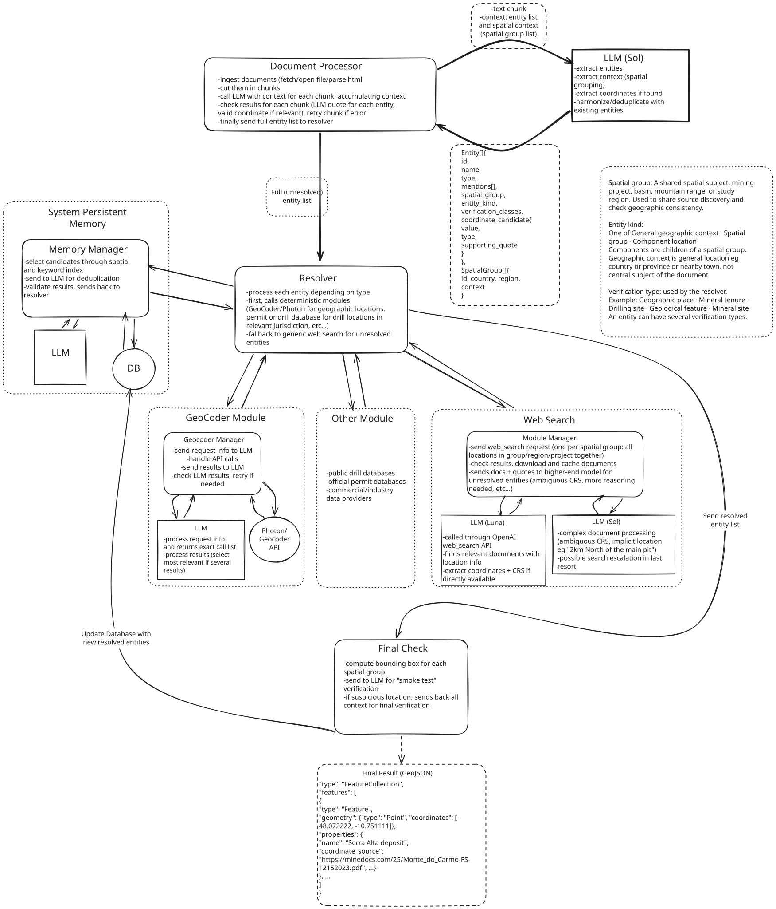

# Georeferencer

This is the design document for our Georeferencer Project (Track A — Textual georeferencing).



## General architecture
Broadly speaking our proposed system is made of three components:
- initial extraction of interesting locations (candidates are called "entity")
- entity coordinate resolution ("resolver"), done by querying various external data source
- final sanity check and result persistence
 
## LLMs vs. deterministic processing

Given the heterogeneity of potential input documents, parsing them through purely deterministic methods is unlikely to be practical. LLMs, by contrast, are well suited to interpreting context, handling typos and inconsistencies, inferring conventions and coordinate systems.

We therefore rely heavily on LLMs for extraction, interpretation, and contextual reasoning, while reserving traditional code-based processing primarily for two purposes:

- **Lightweight validation:** Checking the structure and syntax of LLM outputs, verifying supporting quotations, and performing coordinate validation and transformations where necessary.
- **Context management:** Handling information that exceeds the LLM's practical context window with conventional databases, indexing, and Python-based data processing. For example, the system maintains a database of previously encountered locations, uses spatial indexing to shortlist plausible candidates, and passes these candidates—along with their associated context and mentions—to the LLM for final disambiguation or rejection.

## Fixed schema and domain-aware model

LLMs provide considerable flexibility in data processing. We can rely on them to understand context, determine coordinate systems and conventions, distinguish relevant locations from incidental mentions, and perform other tasks requiring domain knowledge. Most of this domain knowledge is therefore handled by the LLM itself.

However, it is possible to introduce "priors", or simplifying assumptions, on our data that could allow us to design the deterministic part of the system in a much more efficient way. We therefore require the LLM to adhere to a lightweight, domain-aware data model built around two main features:

- **Spatial grouping:** We assume locations are organized into a flat hierarchy of *spatial groups*, representing natural organizational units within a document, for example a mining project, a geological structure, or a broader geographic area. A document may contain several such groups. Extracted locations fall into three categories: **spatial groups** (root entities with no parent), **components** (locations belonging to a parent spatial group), and **independent locations** (higher-level or contextual references, such as countries, regions, or nearby towns). Each spatial group is also assigned a country and region.
- **Verification classes:** Each location receives one or more *verification class* tags based on its type and characteristics. These tags determine which verification methods, external queries, or processing steps should be applied. Examples include drill collars, mining leases, geological features, and mineral or ore bodies.

In addition all entities are enriched with contextual data (mentions in document) and candidate location coordinate, including the convention/coordinate system used.

## Use of external data sources

Following initial extraction by the LLM, identified entities pass through a deterministic, modular processing pipeline.

Depending on their type and verification class, the system queries relevant external sources, for example public mining permit registries, drillhole databases, geological data portals, and commercial data providers, to resolve their precise geographic coordinates.

The final step after going through external data sources is a generic LLM driven web search, using OpenAI's Web Search API. This search returns an array of documents (accessible on the web) mentioning the target locations, with the inferred coordinate if these are easily determined, which will be used for further processing if necessary.

## Cost–performance trade-off

Simple experiments suggest that the task is well within the capabilities of frontier LLMs/LRMs. A relatively simple wrapper around the most powerful model could likely deliver strong results, but at a potentially prohibitive cost.

The challenge is therefore less about raw capability than about finding the optimal **cost–performance trade-off**: achieving an acceptable level of accuracy at the lowest possible cost, or maximizing accuracy within a given computational budget.

With this in mind we try to minimize the system's computing requirements wherever possible. The lion share of the compute cost in the current system comes from the generic web search. The spatial grouping of our target entities allows us to batch-process the locations that are likely to be mentioned in the same documents. Another idea is a multi-level escalation system, with the most expensive models only called if the cheaper models don't provide satisfying results.

## System evaluation

A straightforward evaluation strategy would be to generate synthetic textual datasets of increasing complexity, either from scratch or by modifying an existing document corpus.

Complexity could be introduced by adding errors and inconsistencies, increasing the number of locations mentioned in a document, introducing ambiguous references, or creating contradictory geographic information.

Because in this case the ground truth would be known in advance, we could evaluate performance both **relatively**, by comparing models, prompts and pipeline configurations, and **absolutely**, by measuring the system's ability to identify locations, resolve coordinates, and detect discrepancies.

## Document-centric approach

In keeping with the assignment, the system is designed around the processing of a single document. It extracts locations mentioned within that document and prioritizes the information it contains.

Related documents may subsequently be retrieved, but primarily as supporting evidence or additional context for resolving the extracted locations.

A more natural and potentially more efficient architecture would instead be **location- or project-centric**: gathering all available documents associated with a particular geographic area or mining project, then cross-referencing the locations and information extracted from them.

## Context is king

The system preserves all mentions of each identified location, together with their surrounding context, throughout the processing pipeline.

This information can be reused at any stage for disambiguation, verification, or consistency checks. It can also be persisted as part of the system's knowledge base, providing a growing base of contextual knowledge for future document processing and location resolution.

## Human-in-the-loop vs. full automation

Another important design trade-off concerns the degree of autonomy granted to the system.

For example, the system could be allowed to discover and integrate new external data sources into its verification pipeline when they are deemed relevant. This could be achieved through a standardized connector or secured templating mechanism that would be configured on the fly by the LLM.

On the other hand the current system could easily support an error flagging and notification feature, that could surface encoutered problems and exceptions, and expose them to the system's maintainer/designer in an ergonomic UI. The designer would then decide which modification or improvement is needed - adding a data source, modifying a prompt, etc...


## Demo/PoC

As required by the problem assignment we built a functional document processing PoC. The demo include the main pipeline segment: entity extraction, processing with external data sources including the Photon geocoder and LLM managed web search, and final processing. The app was built in Python with Codex and GPT Sol 6.1, wrapped in a FastAPI server with a full featured debugging UI in React. 

Although the demo is already functional, the resolution rate vary from 75% to 25%. Most of the missing locations could be resolved by implementing some missing features from our proposed architecture as well as improving the existing ones:
- complex reasoning in the web search step (currently not implemented), which would mostly require improving the prompting and result validation. For example a lot of locations are not strictly defined, and therefore would necessitate some kind of approximation convention - this should be specified in the LLM's prompt. 
- adding external API and data sources (currently we only use the Photon Geocoder, which is mostly useful for recognized/named geographic entities, much less for mining related locations)
- adding computer vision capabilities for map processing (a lot of locations are only shown on the document's maps, without explicit coordinates)

This demo has been built with a focus on experimenting/debugging. For example we cache extensively intermediary results at every step of the pipeline, in order to avoid expensive LLM re-runs. Likewise the UI displays as much logs and info as possible.

## Setup and usage

Requires **Python 3.11 or newer**. Real document analysis also requires an OpenAI API key with access to the configured models and web search. The browser UI is served by FastAPI; no separate frontend installation is needed.

### Install

Open a terminal in the repository root. On Windows (PowerShell):

```powershell
python -m venv .venv
.\.venv\Scripts\python.exe -m pip install -e ".[dev]"
Copy-Item .env.example .env
```

On macOS or Linux:

```bash
python3 -m venv .venv
.venv/bin/python -m pip install -e ".[dev]"
cp .env.example .env
```

If `.env` already exists, keep it rather than copying over it. Add your `OPENAI_API_KEY` to `.env`; this file is ignored by Git. The supplied configuration uses:

```dotenv
GEO_MODEL=gpt-6.1-sol
GEO_REASONING_EFFORT=low
GEO_WEB_SEARCH_MODEL=gpt-6-luna
GEO_WEB_SEARCH_REASONING_EFFORT=low
GEO_VERIFICATION_MODEL=gpt-6.1-sol
GEO_VERIFICATION_REASONING_EFFORT=low
GEO_GEOCODER_PROVIDER=photon
GEO_GEOCODER_URL=https://photon.komoot.io/api/
GEO_WEB_SEARCH_ENABLED=true
```

Model names must be available to your API account; change these values if needed. Leave `GEO_REGISTRY_PATH` empty unless using a local registry. `.env` is loaded from the working directory, with existing shell environment variables taking precedence. Restart the server after configuration changes.

### Start the app

From the repository root:

```powershell
.\.venv\Scripts\georeferencer.exe serve
```

On macOS/Linux, use `.venv/bin/georeferencer serve`. Open **http://127.0.0.1:8000/** for the document library and **http://127.0.0.1:8000/docs** for the API documentation. Upload a PDF, text or HTML document, or provide a download URL. Inspect the resulting GeoJSON, extracted entities, evidence and diagnostics. **Try a synthetic example** runs without model calls or an API key.

### CLI and default documents

Windows commands are shown below; on macOS/Linux replace `.\.venv\Scripts\georeferencer.exe` with `.venv/bin/georeferencer`.

```powershell
# Download the default documents without model calls.
.\.venv\Scripts\georeferencer.exe seed-library

# Analyze the default collection; this can incur API charges.
.\.venv\Scripts\georeferencer.exe analyze-library

# Process a text or HTML file and export GeoJSON plus a diagnostic report.
.\.venv\Scripts\georeferencer.exe run document.txt --include-context --output output
```

Use the UI for PDF processing. Startup does not automatically analyze the library. Version-matching results and model responses are reused where applicable. Request limits and the estimated spending threshold are configured in `.env`; reaching a limit leaves unfinished entities visible as pending rather than resolving them silently.

### Stored results and checks

- `data/library/`: document library, saved results and model/geocoder caches.
- `data/source_documents/`: downloaded supporting documents and parsed-text cache.
- `logs/`: structured request events, token usage and errors.
- `output/`: CLI GeoJSON files and diagnostic reports.

Run the deterministic test suite on Windows with `.\.venv\Scripts\python.exe -m pytest`, or `.venv/bin/python -m pytest` on macOS/Linux. It uses fixtures and mocked services rather than paid model calls.
