# Current system and path to production

This design starts with the implemented **Track A: textual georeferencing** POC.
The diagrams describe code that exists. The final section proposes additions;
those components are not present in the application. The priorities correspond to
the five focus areas in [the assignment](../ai-engineering-georeferencer.md#4-stack--deliverables).

## 1. Application architecture today



[Editable Mermaid source](diagrams/current-system.mmd).

The browser calls FastAPI. Library jobs execute in background tasks in the same
Python process, with two active library jobs at a time. The CLI and direct API use
the same pipeline, although their input paths differ: the library adds URL
download, PDF text extraction and contextual chunking; the direct API and ordinary
CLI run accept text/HTML. No separate agent service, message broker, durable worker
queue or vector database is deployed.

SQLite stores library originals, canonical text, the current result and immutable
run history. Local files hold downloaded verification documents, parsed source
text and versioned model-response caches. JSONL events and saved model responses
feed the UI's evidence and debugging sections. Opening a document or restarting
the server does not analyze it again.

| Responsibility | Existing implementation |
|---|---|
| API, UI and document lifecycle | `api.py`, `library.py`, `static/` |
| HTML/text ingestion and PDF decoding | `ingestion.py`, `library.decode_document` |
| Extraction and forward chunk context | `extraction.py`, `chunked_extraction.py`, `chunk_context.py` |
| Entity consolidation and routing | `identity.py`, `routing.py`, `pipeline.py` |
| Geocoders and optional local registry | `sources.py`, `workflows.py` |
| LLM query suggestions | `geocoder_refinement.py` |
| Shared discovery and source verification | `project_discovery.py`, `web_resolution.py` |
| Source snapshots and passage retrieval | `source_documents.py`, `source_passages.py` |
| Evidence checks and coordinate conversion | `validation.py`, `structured_coordinates.py`, `coordinates.py`, `projections.py` |
| Input collar-table shortcut | `coordinate_tables.py` |
| Geometry conflict checks and unit review | `geometry_checks.py`, `semantic_units.py`, `geographic_audit.py` |
| Traces, usage, pricing and local revalidation | `observability.py`, `pricing.py`, `revalidation.py` |

## 2. The reasoning workflow today

For the objects exchanged at each step, open the
[interactive data-flow diagram](diagrams/agent-dataflow.html) in a browser. Each
input/output card exposes property names, complete JSON examples and generated
schemas. The classification view enumerates every current kind, role, verification
class, category and subtype. Processing boxes expose model/prompt metadata and
current instructions. Its bundled examples are saved Monte do Carmo data;
reconstructed request examples are explicitly identified. No calls are made by
the viewer. Regenerate with `python scripts/build_dataflow.py` after installing
the project; the default input is the saved Monte do Carmo library result.



[Editable Mermaid source](diagrams/current-workflow.mmd). Green boxes represent deterministic Python processing, purple boxes LLM calls,
and blue boxes external API calls. Dashed blue boxes are proposed adapters, not
implemented tools. White boxes show documents or the extracted data model. This shows logical dependencies rather than concurrent workers: the
pipeline prepares geocoder results and cached source verification before its
per-entity resolution loop.

### Diagram vocabulary and modular routing

The diagram uses **spatial group** for the existing `semantic_unit` kind and
**component location** for `subaltern_location`; the schema keys have not changed.
General geographic context is separate. Role controls relevance, while verification
type and geographic context select source workflows. The classification is established
by initial recognition, not by a later geocoder result.

Routing adapters share a candidate/evidence contract. New deterministic permit,
drilling, gazetteer or survey API adapters can be registered for suitable entity
types and jurisdictions without replacing extraction or acceptance. These proposed
APIs are drawn with dashed borders; the current registry reads normalized local data.
The diagram abstracts network mechanics and concentrates on reasoning dependencies.

### Recognition establishes the spatial structure

Sol extracts physical locations, their roles, verification classes, identifiers,
mentions and any coordinate claims. Websites, databases, publications and
organizations do not qualify as locations. The first extraction distinguishes:

| Kind | Meaning | Example |
|---|---|---|
| `general_geographic` | Geographic context outside a unit's member extent | Brazil, Tocantins |
| `semantic_unit` | A coherent spatial subject | Monte do Carmo Project; the Pyrenees |
| `subaltern_location` | A location belonging to a named unit; `semantic_unit` contains its ID | Drill hole, target, outcrop or regional feature |

Kind, document role and verification class answer different questions: membership,
relevance and which source family to consult. Corporate contacts and supporting
laboratory locations are excluded by role. Context locations are optionally
included; the library includes them by default. Excluded entities remain inspectable.

Long library documents use sequential chunks of approximately 14,000 characters
with overlap. Each chunk receives accumulated entities and scoped geographic
contexts. The model reuses known IDs; Python remaps new IDs, checks compatible
updates and consolidates duplicate names/identifiers within geographic and unit
context. There is no final LLM reconciliation pass. Exact compatible names can
still merge incorrectly, and similar spelling alone is not enough to merge.

Python anchors mention strings to the canonical text with a document hash and
character offsets, retaining surrounding context. Structured extraction and
evidence validation allow one correction attempt per chunk. Unsupported mentions
and claims can be quarantined individually, but a malformed nested coordinate
claim can still invalidate a whole extraction response before that quarantine.
This is a known limitation, not complete fault isolation.

### Tools enrich locations, with bounded model decisions

Accepted input coordinate claims bypass external discovery. An optional
deterministic shortcut recognizes some input collar tables and restores their
rows and CRS footnotes; it is not a universal table reader.

Geographic places use Photon or Nominatim: region/country first, country-only
fallback, then bounded administrative-name cleanup and document aliases. Remaining
no-match or ambiguous results are batched for Luna to suggest query strings, up
to three new queries per entity. Explicitly linked locations share a semantic
group; unlinked geographic context shares a document-context refinement batch.
Python executes deduplicated queries and keeps the original type, country,
jurisdiction and identity checks. Several qualifying records remain ambiguous.
The model cannot invent a geocoder record or override a conflicting identity.

Mining assets do not use locality geocoding as their resolution route. Cached
reports are checked first. If evidence is insufficient, Luna discovers useful
documents once per semantic unit, with all its candidate members. A unit can be a
project, basin or mountain range. Unlinked geographic fallbacks can have standalone
discovery requests; the whole document does not necessarily make just one request.
One discovery request can contain up to two hosted web-tool actions. These are
distinct from model requests and ordinary Python HTTP calls to Photon.

Python checks that proposed URLs occurred in search-tool sources, independently
downloads up to four documents and reuses their local snapshots across members.
Sol interprets bounded source passages in batches of up to six requested entities.
It returns entity IDs, structured decimal/DMS/projected values, geometry meaning
and separate coordinate, table-header and CRS quotations. Verification has no
web-search tool. Deterministic passage retrieval is lexical and can miss relevant
pages, table context and information conveyed only in a figure.

Live mining-claim, drilling and geological-survey connectors are **not** implemented.
The registry adapter reads user-normalized local exports. Verification classes
identify potential source families, not a universal database or guaranteed match.

### Acceptance is an evidence decision

Python checks quotation presence, copied numeric values, identity references,
coordinate ranges and supported CRS conversion. DMS requires explicit hemispheres;
projected coordinates require usable datum/zone evidence. PROJ transforms supported
systems and retains the original CRS, operation and accuracy metadata. Geographic
coordinates with unspecified datum currently use a labelled WGS84 assumption;
that policy is a shortcut, not evidence that the source used WGS84.

Quotation checks prove that content exists in a source, not that the model assigned
the right row, column or geographic meaning. A drill collar is not automatically a
project centre. Materially conflicting accepted geometries are withheld rather
than averaged. Independent confirmation is separate from coordinate origin: a
downloaded operator report can support a location without independently confirming it.
Different URLs can be mirrors of the same evidence.

The final unit extent uses only resolved, explicitly linked subaltern locations,
excluding country/province context and the unit's own representative point.
Antimeridian crossing is handled. One compact Sol review checks eligible extents
and supplied extreme members. Suspicion sets `flagged` and a review reason without
altering coordinates. This review is coarse: it does not audit every interior
point and does not establish the project's true boundary.

The result contains accepted GeoJSON features plus every unresolved, excluded or
conflicting entity, source evidence, issues, usage and estimated cost. Identity-only,
source-unavailable, conversion and budget states remain distinguishable. A partial
result is useful output, not a claim that the document was fully resolved.

## 3. Existing cost, retry and observability controls

The current defaults use Sol with low reasoning for extraction, source verification
and extent review; Luna with low reasoning for discovery and query refinement.
Models and effort are configurable. Caches distinguish document/context, source
hashes, prompt/model versions and reasoning settings. Cached responses cost zero
in the replaying run; provider token-cache usage is priced separately.

Per-run limits bound discovery, verification, geocoder calls, downloads and optional
reviews/refinements. The default $0.50 spending threshold is a **soft estimate**:
the last request can exceed it, and missing provider usage leaves cost uncertain.
Budget-limited work is pending, not treated as an unsuccessful search. Schema
correction, query refinement and transient transport retry address different
failures; none is an unrestricted self-correction loop.

Originals and response caches survive a restart. A compatible saved run can reuse
resolved/excluded entities when continuing unfinished work. A free revalidation
action rechecks saved evidence without model/network calls. However, a process
crash before the run is saved has no durable per-stage checkpoint. Interrupted
library jobs are marked as such on startup and require explicit recovery.

The UI exposes exact extraction responses, search actions, source passages, query
attempts, rejection reasons, review flags and stage-specific costs. Events include
request/entity IDs, versions, timings and provider usage. This explains observed
failures, but there are no fleet dashboards or automatic quality-regression alerts.
Stored quotations and raw responses can contain sensitive document content; logs
have no production access-control or retention policy yet.

### Observed narrow-slice result, not an accuracy benchmark

On 12 October 2026 the July 2022 Monte do Carmo release produced 36 entities:
22 resolved, 8 unresolved and 6 excluded, with none pending after a local refresh
that resolved Tocantins. Seventeen input collars and Serra Alta supplied 18 unit
points, whose extent review returned plausible. The preceding full live run cost
approximately $0.29, and the targeted Luna refinement test approximately $0.00013.
The original live run resolved 21 entities; the subsequent refresh did not repeat it.

The 196 automated tests validate control flow and deterministic behavior using
mocked provider responses. They do not measure model precision/recall. Actual
failures include a source HTML encoding error, inaccessible downloads and source
passages identifying targets without acceptable coordinates.

## 4. What to add next, and why

These are proposals. They do not change the current workflow or require another run.

| Focus area | Addition | Why / validation |
|---|---|---|
| Agent design | Isolate invalid coordinate claims before validating the entire response; page/section-aware context retrieval | Keep valid entities when one claim is malformed; test a valid response with one corrupted CRS/DMS claim |
| Tool use | Charset-aware HTML decoding, explicit table/page provenance, source freshness and jurisdiction-specific registry connectors | Fix the observed USGS decoding failure; retrieve headers/footnotes together; replay saved source fixtures |
| Self-correction | Failure-specific recovery states and explicit stop reasons | A 403 needs a different source; missing table context needs retrieval; an ambiguous name needs review, not repeated conversion |
| Confidence | Reviewed evidence tiers and geographic consistency checks | Separate identity support, geometry validity, independence and review warnings; avoid an uncalibrated LLM confidence percentage |
| Observability | Aggregated traces/metrics, versioned replay corpus and release comparisons | Detect a prompt losing entities or a provider changing record types, not just exceptions |
| Evaluation | A small manually annotated, stratified reference set | Measure omissions and incorrect matches independently of the model's proposed entities |
| Scale | Durable jobs, stage checkpoints, shared object storage and a transactional metadata store | Resume across worker crashes; stop paid work being repeated across workers |

### First: evidence quality and recovery

Keep the existing distinction between semantic interpretation and Python checks.
Make retrieval preserve page IDs, table headers, row IDs, footnotes and CRS scope.
Use an LLM to recognize heterogeneous tables; use Python to verify supplied
evidence and convert values. Improve precision before expanding the number of
searches. Add a source policy recording authority, freshness and common origin;
two mirrors must not count as independent verification.

For wrong hemisphere, axis order or country, deterministic checks can flag
contradictions against declared CRS and country boundaries. They should not silently
flip signs or select a nearby town. An unresolved local grid remains unresolved
until its transform is supported. The current WGS84 assumption should become a
configurable, evaluated acceptance policy with explicit uncertainty.

Map reading and relative statements need separate opt-in workflows. For example,
"2 km east of the main pit" requires an identified anchor, direction/distance
evidence and a derived geodesic point with uncertainty. A zone could instead gain
a derived extent from explicitly associated collars. Such geometry must be labelled
derived, with its inputs retained; it is not a quoted survey point or a legal boundary.
Maps require figure detection, coordinate/grid cues, ground-control evidence and
geometric residual checks. These are extensions, not implemented Track B support.

### Then: durable execution across thousands of documents

Keep the modular pipeline, but move library jobs out of FastAPI background tasks.
A practical first deployment uses API instances, independently scalable parsing
and resolution workers, a durable leased job table in PostgreSQL, and object
storage for originals/source snapshots. Avoid a separate service for every stage
until throughput requires it. Use document hashes, tenant scope, stage versions
and input hashes as idempotency keys; persist completed stage artifacts and
checkpoint each group/batch. At-least-once delivery must not duplicate accepted
results. A provider timeout can still leave uncertain billing, so do not promise
exactly-once external model execution.

Apply provider-wide rate/concurrency limits, jittered transient retries, circuit
breakers and per-job deadlines. Reserve a conservative estimated request budget
transactionally before workers call models, reconcile usage afterwards, and retain
reservations when usage is unknown. Add per-tenant quotas, a controlled override
for pending work and fair scheduling. Cache by source version and enforce refresh
policies; cross-tenant caching must respect document confidentiality.

Add authentication, tenant isolation, private trace access, retention/deletion,
secret management and bounded parser resources. Preserve the existing public-URL
and redirect protections, and treat document/tool content as untrusted data.
Return partial results promptly with clear pending/unavailable reasons instead
of letting one inaccessible report block the whole document.

### Evaluation and monitoring without an existing ground-truth dataset

Start with a small reviewed corpus spanning releases, surveys, technical reports
and noisy/negative examples. Annotators inspect the full documents, not merely
model candidates, and label physical entities, roles, unit membership, evidence
and acceptable geometry meaning. Resolve disagreements and record genuinely
unlocatable references. Keep prompt-development and held-out projects/sources
separate so mirrors and related releases do not leak across the split.

Measure entity precision/recall, wrong/missed merges, relevance and parent-link
accuracy, accepted-location precision, and coverage among references judged
resolvable. Geometry checks need meaning-specific distance/overlap tolerances;
city representative points and drill collars should not share one tolerance.
Report document/type/country/table-layout slices alongside cost and latency.
Test mutations such as missing degree signs, northing-first headers, unknown
zones, wrong row IDs, source outages and ambiguous same-name locations.

Production dashboards should track those evaluation metrics by prompt/model
version, plus stage latency, budget pauses, cache reuse, missing usage, source
failures and coordinate/role distributions. Counts and unresolved rates are
warning signals, not accuracy measurements. Shadow a proposed prompt on the fixed
replay corpus, compare against reviewed labels, then canary and sample new output.
A second model can help triage suspicious cases; it is not the sole ground truth.

## 5. Regenerating the diagrams

The `.mmd` files are the editable sources; SVGs are committed so a reviewer needs
no tooling to view them. The Python script invokes a pinned
[Mermaid CLI](https://github.com/mermaid-js/mermaid-cli), which renders Mermaid to
SVG, PNG or PDF. Node.js is a documentation-only dependency, not an app dependency.
The first rendering command downloads the pinned CLI through npx; installed Chrome
avoids downloading another browser.

```powershell
.\.venv\Scripts\python scripts/render_diagrams.py --browser "C:/Program Files/Google/Chrome/Application/chrome.exe"
```

For sharing slides, add `--format png` or `--format pdf`. Edit the Mermaid sources
and rerun the script. Rendering makes no LLM calls and changes no library results.
